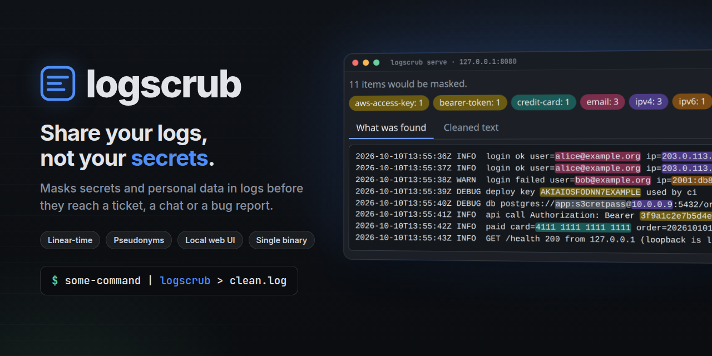
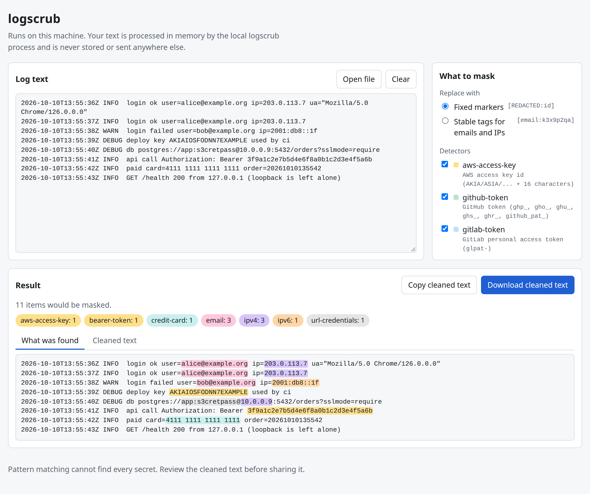

# logscrub



Mask secrets and personal data in logs so they can be shared safely (bug reports, tickets, chat).

```sh
some-command | logscrub > clean.log
logscrub app.log                 # files work too
logscrub --check app.log         # CI gate: exit 1 if anything would be masked
logscrub --report app.log        # counts per detector, never the matched text
logscrub --mode pseudonym app.log          # stable tags for emails and IPs: the log stays debuggable
logscrub --config logscrub.toml app.log    # allow-list, custom rules, enable/disable detectors
logscrub serve                             # local web UI: paste or drop a log, see what would be masked
```

```text
$ printf 'GET /cb?access_token=abc123\nconnect postgres://app:s3cret@db/x\n' | logscrub
GET /cb?access_token=[REDACTED:kv-secret]
connect postgres://[REDACTED:url-credentials]@db/x
```

## What it masks

**Secrets:** AWS access and secret keys, GitHub / GitLab / Slack / Stripe tokens, JWTs, PEM private keys (including multi-line blocks), `Authorization` headers and long Bearer tokens, `user:password@` in URLs, and `password=` / `token=` / `"api_key": "..."` style pairs.

**Personal data:** email addresses, IPv4 and IPv6 addresses (loopback is left alone), payment card numbers (Luhn-checked, known issuer prefixes), and, if you enable it, international phone numbers.

`logscrub --list-detectors` lists them. Version strings (`Chrome/126.0.0.0`), timestamps, MAC addresses, `ssh://git@host` and `icon@2x.png` are guarded by tests so they stay untouched.

**Pseudonym mode** replaces emails and IPs with `[email:k3x9p2qa]`-style tags derived from an HMAC key, so the same address maps to the same tag across a file and across runs (give `--key-file` or `LOGSCRUB_KEY`). Secrets always get a fixed marker, never a tag. See the [wiki](https://github.com/hbenali/logscrub/wiki/Configuration) for the config file. The roadmap is in [docs/SPEC.md](docs/SPEC.md).

## Web UI



`logscrub serve` opens a local page (default `http://127.0.0.1:8080`): paste or drop a log, see every match highlighted by detector, toggle detectors, switch between markers and stable tags, and download the cleaned text. It uses the same engine as the CLI. The text is processed in memory by the local process; the page loads nothing from anywhere else (strict CSP, no CDN, no analytics). It listens on loopback only unless you pass `--allow-remote`, because it has no authentication. See the [wiki](https://github.com/hbenali/logscrub/wiki/Web-UI).

<details>
<summary>Stable tags for emails and IPs, dark theme</summary>

![The cleaned text with stable tags such as [email:ggyjbrrk] and [ipv4:znrrpfi2]; secrets keep fixed markers](docs/screenshots/web-ui-pseudonyms.png)

</details>

## Why another one

- **Linear-time matching.** Go's RE2 engine: hostile input cannot trigger ReDoS.
- **Measured false positives.** A "must not change" corpus of realistic logs runs in CI; `max_tokens=100` and `ssh://git@host` stay untouched.
- **Bounded memory, fail closed.** Streams line by line; a line it cannot scan safely is an error (exit 3), never passed through.
- **No network, no files written, never echoes what it finds.** Reports and errors contain counts and ids only.
- One static binary, a distroless Docker image, signed releases, and a web UI that cannot phone home.

## Stability

From 1.0, the command-line flags, exit codes, the config file format and the `[REDACTED:id]` / `[kind:tag]` output formats are stable across 1.x. New detectors may be added in minor releases, so a log that was clean before can have new matches; `--check` is the way to notice.

## Install

Binaries on [Releases](https://github.com/hbenali/logscrub/releases); `docker run --rm -i hbenali/logscrub < app.log` (also `ghcr.io/hbenali/logscrub`); or `go install github.com/hbenali/logscrub/cmd/logscrub@latest`.

## Limits

Regex detection cannot find secrets with no recognisable shape (a password in prose, an unlabelled random string) or encoded ones (base64, URL-encoded). Review the output before sharing it publicly; `--check` in CI lowers the risk, it does not remove it.

Docs: [wiki](https://github.com/hbenali/logscrub/wiki), [SECURITY.md](SECURITY.md), [CONTRIBUTING.md](CONTRIBUTING.md). MIT licensed.
